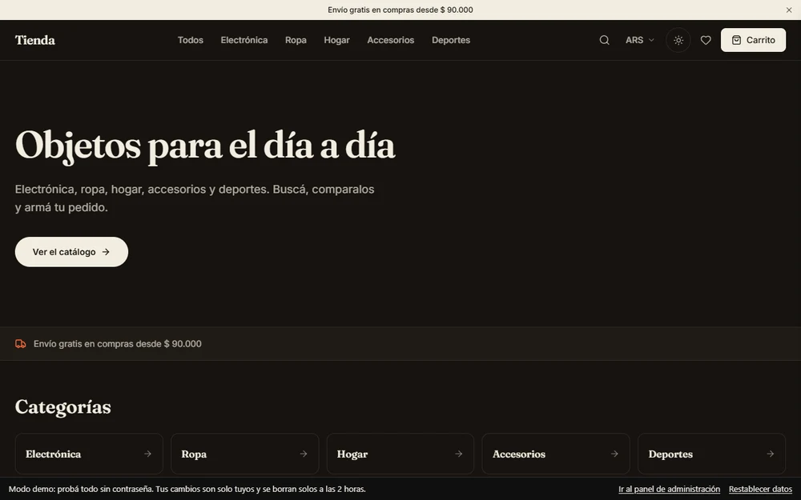
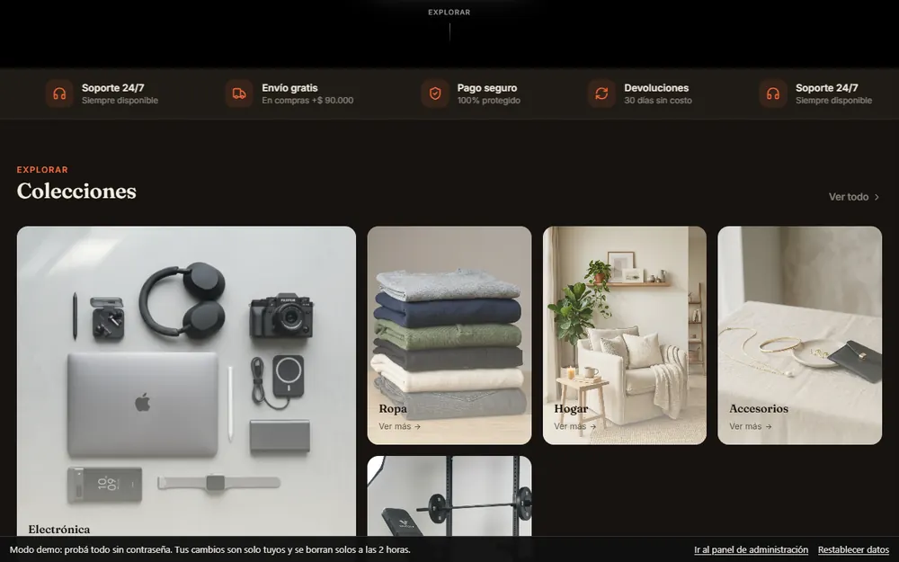
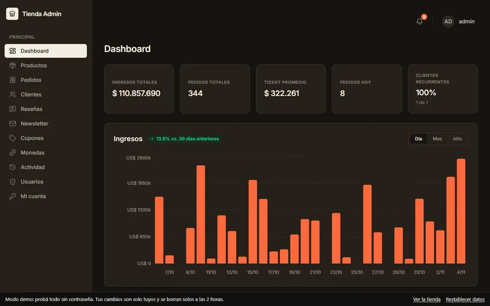
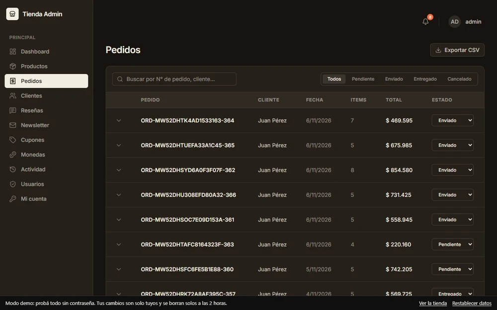

# Tienda

Tienda online con catálogo, carrito, checkout simulado y un panel de administración. El frontend es React con TypeScript y Tailwind; el servidor es Express con una base SQLite.

Demo: https://tienda-demo-1f6b.onrender.com. El panel de administración está en `/admin` y en la demo se entra sin contraseña. Es un servidor gratuito: si estaba dormido, la primera carga tarda unos segundos.

La demo le da a cada visitante su propia copia de la base de datos. Esa parte no está en este repositorio.






Más trabajos en mi portfolio: https://portfolio-fawn-kappa-35.vercel.app

## Qué tiene

**Tienda**
- Catálogo con búsqueda, filtro por categoría y orden.
- Página de cada producto, con reseñas.
- Carrito, lista de deseos, comparador de productos y seguimiento de pedido.
- Checkout simulado: no se cobra nada.
- Selector de moneda y modo claro u oscuro.

**Panel de administración** (`/admin`)
- Dashboard de ingresos por día, mes y año, con gráficos hechos con `recharts`.
- Productos (alta, edición y baja), pedidos (con vista para imprimir), clientes, reseñas, newsletter, cupones, monedas y registro de actividad.
- Usuarios del panel con dos roles, `owner` y `staff`.

## Stack

- Frontend: Vite, React 19, TypeScript, Tailwind CSS 4, React Router 7, `recharts`, `sonner` y `lucide-react`.
- Servidor: Express 5, `node:sqlite` (la base es el archivo `server/data.db`), `zod` para validar, `helmet` y `express-rate-limit`.
- Sesión del panel: JWT en una cookie `HttpOnly`, con contraseñas guardadas con `bcryptjs`.

## Cómo correrlo

```bash
npm install
npm run dev
```

`npm run dev` levanta el cliente (Vite) y el servidor a la vez. Otros comandos: `npm run build`, `npm run lint` y `npm run backup`.

### Panel admin

En `/admin`. En desarrollo la contraseña inicial se genera al azar y se imprime una vez en la consola del server (o definila con `ADMIN_PASSWORD`).

### Producción

Variables obligatorias (ver `.env.example`): `NODE_ENV=production`, `ADMIN_JWT_SECRET` (≥32 caracteres), `ADMIN_PASSWORD` (≥12, solo para crear el admin inicial), `CORS_ORIGIN` si el front está en otro dominio y `TRUST_PROXY=1` detrás de un proxy. El server se niega a arrancar con secretos por defecto. Servir siempre por HTTPS.

`npm run build && npm start` sirve la API y el frontend compilado desde el mismo proceso (con cabeceras CSP/HSTS y redirección a HTTPS si hay `TRUST_PROXY`). La sesión de admin va en una cookie `HttpOnly` + `SameSite=Strict`, con header anti-CSRF.

**Roles:** `owner` (todo, incluida la gestión de usuarios en `/admin/users`) y `staff` (productos, pedidos, reseñas; sin cupones, monedas, actividad ni borrados). **Backups:** automáticos al arrancar y cada 24 h en `server/backups` (`BACKUP_DIR`, `BACKUP_KEEP`); manual con `npm run backup`. **Reseñas:** las nuevas quedan ocultas hasta aprobarlas en Admin → Reseñas → Restaurar.

### Build de producción

```bash
npm run build
npm run preview
```

## Estructura

```
src/
  types/        tipos (producto, carrito, pedido, reseña, lista de deseos)
  data/         servicios que hablan con la API (productos, pedidos, reseñas)
  context/      carrito, lista de deseos, tema, moneda y sesión del panel
  hooks/        useCart, useWishlist, useTheme, useProductFilters, entre otros
  components/   componentes por área (catalog, cart, checkout, product, compare, admin, layout)
  pages/        páginas de la tienda y del panel
server/
  routes/       productos, pedidos, reseñas, cupones, monedas, newsletter, actividad y admin
  db.ts         esquema y acceso a SQLite
  auth.ts       sesión del panel
```
